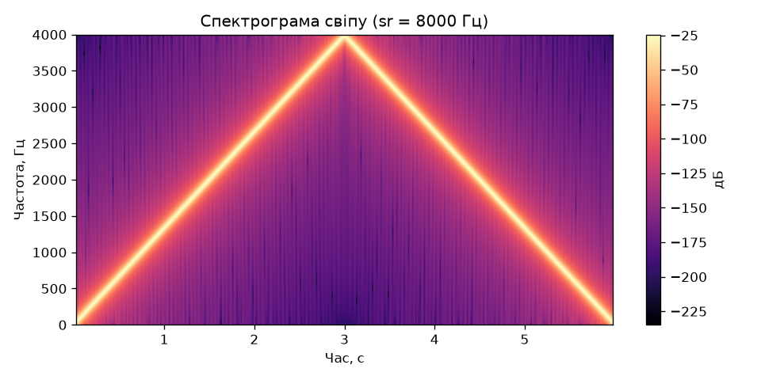
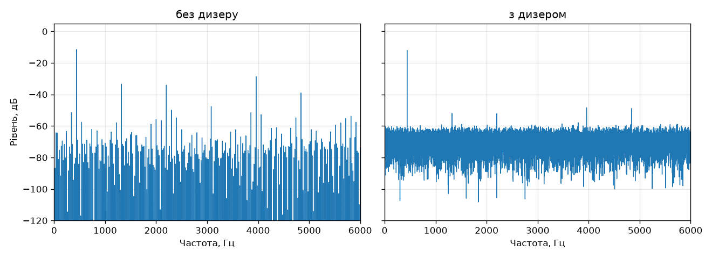

# Лабораторна робота № 12. Синтез звуку і межа Найквіста

**Дисципліна:** Розробка мультимедійних застосунків
**Спеціальність:** 122 Комп'ютерні науки, група КН-3/1
**Виконав:** Хом'як

## Мета роботи

Згенерувати звук формулою, записати його у WAV, дослідити аліасинг за межею Найквіста, вплив розрядності квантування та дизеру, порівнявши результат на слух і за метриками.

## Структура репозиторію

| Файл | Призначення |
|------|-------------|
| `lab12.py` | Код роботи: `tone`, `sweep`, `quantize`, `dither` і тести |
| `tone_220.wav`, `tone_440.wav`, `tone_880.wav` | Чисті тони |
| `sweep.wav`, `sweep.png` | Свіп 0…8000 Гц при sr = 8000 Гц і його спектрограма |
| `alias_3000.wav`, `alias_5000.wav`, `alias_7000.wav` | Тони для демонстрації аліасингу |
| `quant_16bit.wav`, `quant_8bit.wav`, `quant_4bit.wav` | Квантування до 16, 8 і 4 бітів |
| `dither_off.wav`, `dither_on.wav`, `dither.png` | Тихий тон без дизеру та з дизером |

## Запуск

```bash
python lab12.py
```

Скрипт генерує всі WAV-файли й картинки та виконує тести (виводить «ТАК» або «НІ» для кожної перевірки).

## Хід роботи

### Завдання 1. Чисті тони

Я заповнив функцію `tone`: час рахується як `np.arange(...) / sr`, тобто в секундах, а не в номерах відліків, після чого береться синус.

```python
def tone(freq, dur=2.0, amp=0.5, sr=SR):
    t = np.arange(int(dur * sr)) / sr
    return amp * np.sin(2 * np.pi * freq * t)
```

Я згенерував `tone_220.wav`, `tone_440.wav` і `tone_880.wav`. Усі три звучать як одна нота (ля) у трьох октавах, пік спектра 440 Гц збігається із заданим.

### Завдання 2. Свіп за межу Найквіста

Я написав `sweep` за формулою з накопиченою фазою, бо частота є швидкістю зростання фази, а не множником при часі:

```python
def sweep(f0, f1, dur, amp=0.5, sr=SR):
    t = np.arange(int(dur * sr)) / sr
    ph = 2 * np.pi * (f0 * t + (f1 - f0) / (2 * dur) * t ** 2)
    return amp * np.sin(ph)
```

Тест на п'яти вікнах для свіпу 200→800 Гц за 4 с дав **260, 380, 500, 620 і 740 Гц**, що збігається з очікуваним.

Далі я зробив `sweep.wav` при `sr = 8000` Гц (від 0 до 8000 Гц за 6 с). Тон піднімається приблизно до третьої секунди, а потім спускається вниз. На спектрограмі видно «Λ»-подібну лінію з піком на 4000 Гц.



*Рисунок 1 — Спектрограма свіпу 0…8000 Гц при sr = 8000 Гц*

Окремі тони при `sr = 8000` Гц:

| Задана частота, Гц | Виміряна пікова частота, Гц | Пояснення |
|--------------------|-----------------------------|-----------|
| 3000 | 3000 | нижче межі Найквіста |
| 5000 | 3000 | 8000 − 5000 = 3000 |
| 7000 | 1000 | 8000 − 7000 = 1000 |

### Завдання 3. Розрядність

Я реалізував `quantize`:

```python
def quantize(x, bits):
    L = 2 ** bits
    k = L / 2 - 1
    return np.round(x * k) / k
```

Я проквантував тон 440 Гц з амплітудою 0,9 до 16, 8 і 4 бітів та виміряв SNR:

| Біт | Рівнів | Виміряний SNR, дБ | Теорія 6,02·N + 1,76, дБ |
|-----|--------|-------------------|--------------------------|
| 16 | 65 536 | 97,3 | 98,1 |
| 8 | 256 | 49,0 | 49,9 |
| 4 | 16 | 24,2 | 25,8 |

*Таблиця 1 — Квантування синусоїди 440 Гц амплітудою 0,9*

Виміряні значення на 0,8–1,6 дБ менші за теоретичні, бо формула виведена для сигналу на повну шкалу, а амплітуда тону 0,9.

### Завдання 4. Дизер

Я реалізував `dither`: до сигналу **перед** округленням додається рівномірний шум в межах ±півкроку квантування.

```python
def dither(x, bits, seed=0):
    rng = np.random.default_rng(seed)
    step = 2 / 2 ** bits
    return quantize(x + rng.uniform(-step / 2, step / 2, len(x)), bits)
```

Для тихого тону 440 Гц (амплітуда 0,25) при 4 бітах я зберіг `dither_off.wav` і `dither_on.wav` та побудував спектри.



*Рисунок 2 — Спектри без дизеру та з дизером*

Без дизеру в спектрі видно окремі піки гармонік, з дизером — рівний шумовий фон.

| Метрика | Без дизеру | З дизером |
|---------|------------|-----------|
| Найгучніша гармоніка, дБ | −17,1 | −36,4 |
| SNR, дБ | 12,0 | 9,6 |

Найгучніша гармоніка впала приблизно на 19 дБ, а SNR погіршився на 2,4 дБ.

## Що чути в кожній парі файлів

- **tone_220 / tone_440 / tone_880:** чистий рівний тон без сторонніх звуків, кожен наступний звучить рівно на октаву вище.
- **alias_3000 і alias_5000:** звучать однаково, хоча задані частоти різні, бо при sr = 8000 Гц частота 5000 Гц відбивається в 8000 − 5000 = 3000 Гц.
- **quant_16bit і quant_8bit:** майже не відрізняються на слух, обидва чисті.
- **quant_4bit:** з'явилося деренчання, якого в чистій синусоїді немає, це гармоніки похибки округлення.
- **dither_off і dither_on:** без дизеру тихий тон деренчить, бо похибка повторює форму сигналу. З дизером з'явився рівний тихий шипіт, але деренчання зникло, і тон звучить чистіше та природніше, хоча за числами SNR гірший.

## Відповіді на запитання

**2. Що відбувається на третій секунді `sweep.wav`?**
На третій секунді задана частота досягає 4000 Гц, тобто межі Найквіста (sr/2 при sr = 8000 Гц). Далі задана частота f > 4000 Гц відбивається в чутний діапазон як 8000 − f, тому тон розвертається й іде вниз, хоча фаза продовжує зростати.

**3. Чому `alias_3000` і `alias_5000` звучать однаково?**
Дискретні відліки не відрізняють синусоїди частот f і sr − f: при sr = 8000 Гц сигнали 5000 і 3000 Гц дають однакові значення в усіх вузлах дискретизації (8000 − 5000 = 3000). Це і є аліасинг: частота вище межі Найквіста складається назад у нижчий діапазон.

**6. Дизер погіршив SNR на 2,4 дБ. Чому тоді його застосовують?**
Дизер додає шум, тому SNR падає (з 12,0 до 9,6 дБ). Але без нього похибка квантування корельована із сигналом і перетворюється на гармоніки, які вухо добре чує як деренчання. Дизер робить похибку некорельованою із сигналом, вона стає рівним шумом, який вухо помічає значно гірше. Суб'єктивна якість зростає, хоча метрика погіршується.

## Висновки

Я згенерував тони формулою, переконався, що свіп потрібно будувати через накопичену фазу, почув і виміряв аліасинг за межею Найквіста, порівняв квантування 16/8/4 біти (SNR близький до 6,02·N + 1,76 дБ) і показав, що дизер погіршує SNR, але прибирає гармоніки округлення, тож звучить краще.