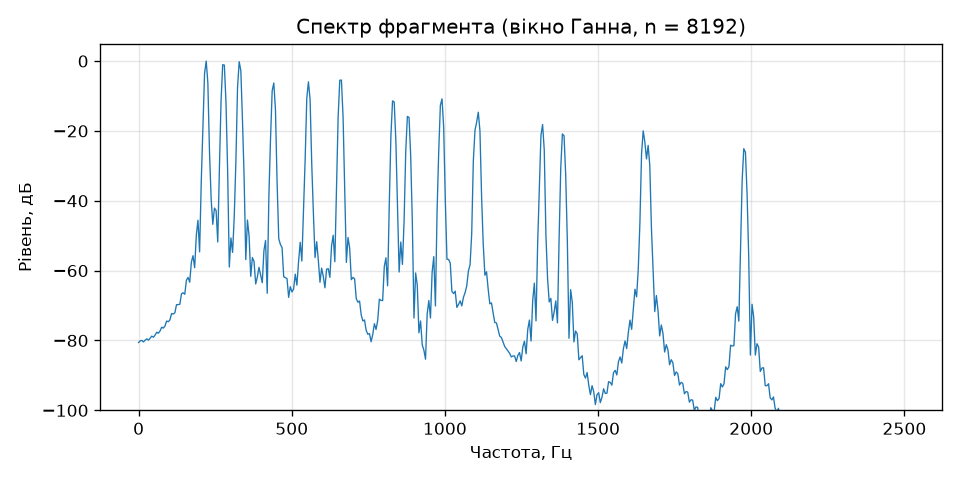
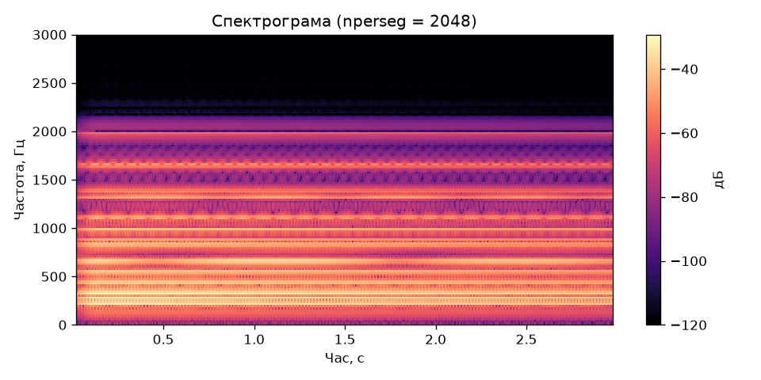
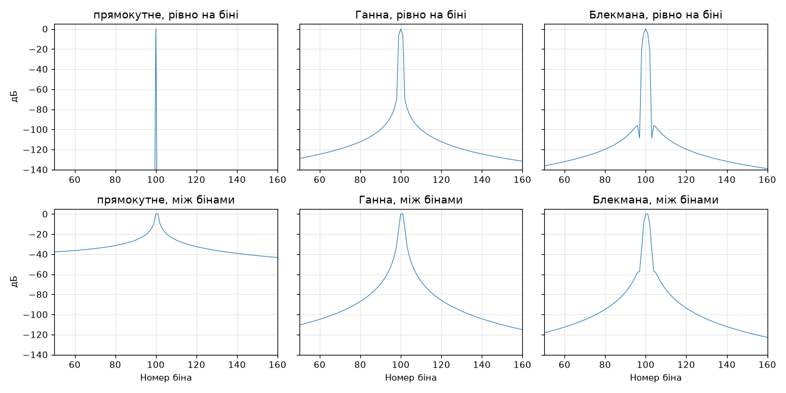
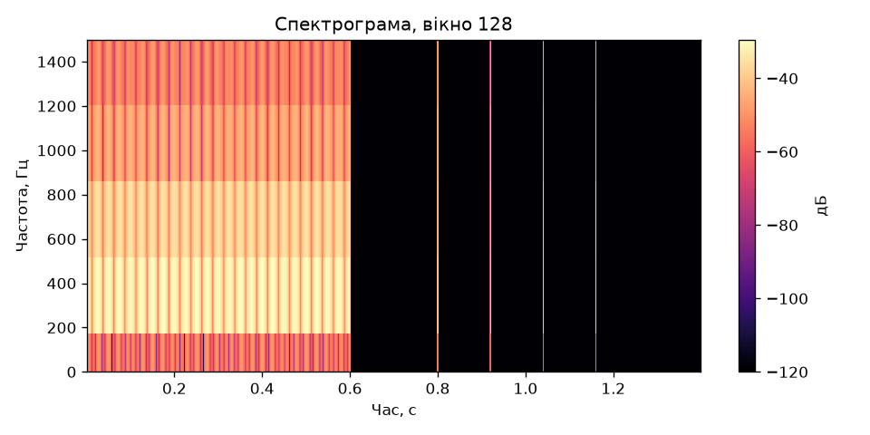
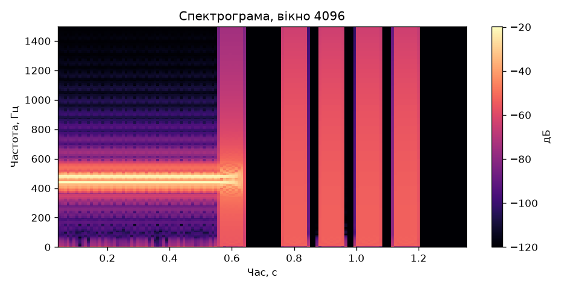
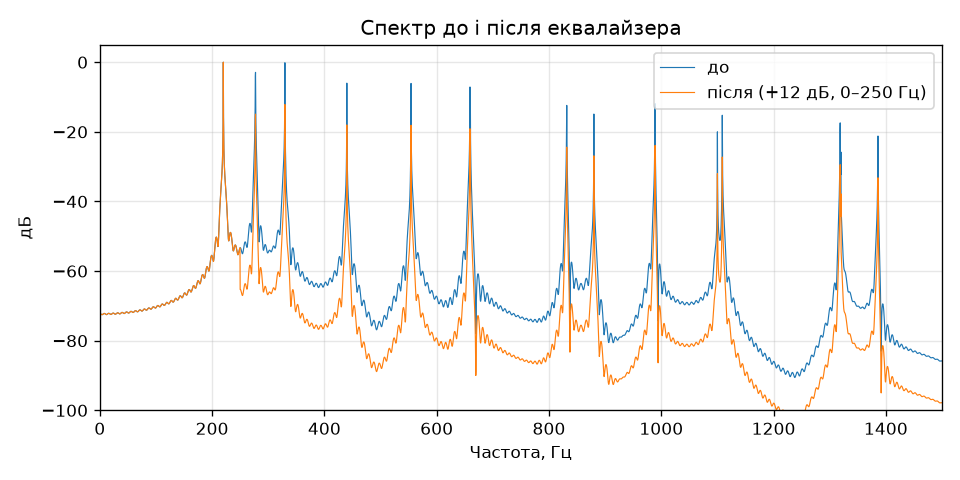

# Лабораторна робота № 13. Спектральний аналіз

**Дисципліна:** Розробка мультимедійних застосунків
**Спеціальність:** 122 Комп'ютерні науки, група КН-3/1
**Виконав:** Хом'як

## Мета роботи

Подивитися на звук як на набір частот: побудувати спектр і спектрограму, виміряти розтікання спектра для різних вікон, показати компроміс між роздільністю за часом і за частотою та зібрати еквалайзер, перевіривши його числами.

## Структура репозиторію

| Файл | Призначення |
|------|-------------|
| `lab13.py` | Код роботи: `music`, `eq`, `band_energy` і всі експерименти |
| `source.wav` | Вихідний сигнал (акорд ля-мажор) |
| `spectrum.png`, `spectrogram.png` | Спектр фрагмента та спектрограма акорду |
| `windows.png` | Порівняння вікон: тон рівно на біні та між бінами |
| `spec_128.png`, `spec_4096.png` | Спектрограми з вікнами 128 і 4096 |
| `eq_spectrum.png` | Спектр до і після еквалайзера |
| `preset_bass.wav`, `preset_voice.wav`, `preset_phone.wav` | Три пресети еквалайзера |

## Запуск

```bash
pip install numpy scipy matplotlib
python lab13.py
```

Скрипт створює всі WAV-файли й картинки та виводить виміряні значення. Остання перевірка друкує «ТАК», якщо еквалайзер підняв задану смугу рівно на 12 дБ, а решта смуг не змінилася.

## Хід роботи

### Завдання 1. Спектр і спектрограма

Я згенерував акорд ля-мажор функцією `music` (ноти 220, 277,18 і 329,63 Гц, по шість гармонік кожної, з атакою та затуханням) і зберіг його як `source.wav`. Спектр фрагмента з 8192 відліків, помножених на вікно Ганна, показав окремі піки поблизу 220, 277 і 330 Гц та їхніх гармонік.

```python
n = 8192
sp = np.abs(np.fft.rfft(x[:n] * np.hanning(n)))
db = 20 * np.log10(sp / sp.max() + 1e-12)
fr = np.fft.rfftfreq(n, 1 / SR)
```



*Рисунок 1 — Спектр фрагмента (вікно Ганна, n = 8192)*

Спектрограму всього сигналу побудовано з вікном 2048 і перекриттям 1792 у логарифмічному масштабі.



*Рисунок 2 — Спектрограма акорду (nperseg = 2048)*

### Завдання 2. Порівняння вікон

Я порівняв прямокутне вікно, вікно Ганна та вікно Блекмана на двох тонах при n = 1024:

- тон потрапляє рівно на біна №100 (цілу кількість періодів у вікні);
- тон зсунуто на пів біна (100,5).

Вимірювався найвищий сторонній пік поза околом основного піка.

| Вікно | Рівно на біні, дБ | Між бінами, дБ |
|-------|-------------------|----------------|
| Прямокутне | −283,0 | −21,0 |
| Ганна | −91,1 | −52,6 |
| Блекмана | −100,0 | −62,3 |

*Таблиця 1 — Найвищий сторонній пік (розтікання спектра)*

Рівно на біні розриву на краях немає, тому прямокутне вікно дає практично нуль (−283 дБ). Між бінами воно дає лише −21 дБ, а Ганна й Блекмана — −53 і −62 дБ, тобто чистіше більш ніж на 30 дБ.



*Рисунок 3 — Один тон, два випадки, три вікна*

### Завдання 3. Час проти частоти

Я зібрав сигнал: 0,6 с двох близьких тонів (440 і 480 Гц), далі чотири клацання (0,80; 0,92; 1,04 і 1,16 с). Спектрограми побудовано з вікнами 128 і 4096.



*Рисунок 4 — Спектрограма, вікно 128*



*Рисунок 5 — Спектрограма, вікно 4096*

| Вікно | Що видно | Що зникло |
|-------|----------|-----------|
| 128 (крок по частоті ≈ 345 Гц, ≈ 2,9 мс) | Чотири клацання як окремі вертикальні лінії | Два тони злилися в одну широку смугу, бо відрізняються лише на 40 Гц |
| 4096 (крок по частоті ≈ 10,8 Гц, ≈ 93 мс) | Два тони розділені на дві тонкі лінії | Клацання розмазалися в часі на ширину вікна й втратили точне положення |

**Вибір вікна.** Для аналізу мови я б узяв коротке вікно (приблизно 512–1024 відліків, 10–25 мс): звуки мови змінюються швидко, і важливо бачити зміни в часі. Для настроювання гітари — довге вікно (4096 і більше): звук майже стаціонарний, і потрібна дрібна точність по частоті, щоб помітити розбіжність у кілька герц.

### Завдання 4. Еквалайзер

Я реалізував еквалайзер у три кроки: у спектр через `rfft`, помножити смуги, назад через `irfft` з явно вказаною довжиною.

```python
def eq(x, bands, sr=SR):
    sp = np.fft.rfft(x)
    fr = np.fft.rfftfreq(len(x), 1 / sr)
    g = np.ones(len(sp))
    for lo, hi, db in bands:
        g[(fr >= lo) & (fr < hi)] = 10 ** (db / 20)
    return np.fft.irfft(sp * g, len(x))
```

Для перевірки числом я підняв смугу 0–250 Гц на 12 дБ і виміряв енергію в чотирьох смугах:

| Смуга, Гц | До, дБ | Після, дБ | Зміна, дБ |
|-----------|--------|-----------|-----------|
| 0–250 | 79,6 | 91,6 | +12,00 |
| 250–1000 | 84,4 | 84,4 | 0,00 |
| 1000–4000 | 69,8 | 69,8 | 0,00 |
| 4000–22050 | 28,0 | 28,0 | 0,00 |

*Таблиця 2 — Енергія по смугах до і після еквалайзера*



*Рисунок 6 — Спектр до і після еквалайзера*

Енергія першої смуги зросла рівно на 12,0 дБ, а решта смуг не змінилася з точністю до сотих.

Я зберіг три пресети (перед записом сигнал нормується за максимумом, щоб не було кліпінгу):

| Файл | Налаштування |
|------|--------------|
| `preset_bass.wav` | +12 дБ на 0–250 Гц |
| `preset_voice.wav` | −12 дБ на 0–150 Гц, +6 дБ на 1000–4000 Гц |
| `preset_phone.wav` | залишено лише 300–3000 Гц (решта −60 дБ) |

## Відповіді на запитання

**1. Чому той самий тон, зсунутий на пів біна, розмазується по всьому спектру?**
Перетворення Фур'є вважає, що вирізаний фрагмент повторюється нескінченно. Якщо тон не вкладається у вікно цілу кількість періодів, початок і кінець фрагмента не збігаються, і при періодичному повторенні виникає розрив, якого в сигналі не було. Розрив має широкий спектр, тому енергія розтікається по всіх бінах. Рівно на біні розриву немає, і пік ідеальний.

**3. Який розмір вікна для аналізу мови й чому?**
Приблизно 512–1024 відліків при 44100 Гц (11,6–23 мс). Мова змінюється за десятки мілісекунд, тому вікно має бути коротшим за ці зміни. Крок по частоті 43–86 Гц достатній, щоб розрізнити гармоніки голосу та форманти. Довше вікно змазало б зміну звуків у часі, коротше не розділило б гармоніки.

**6. Чим еквалайзер відрізняється від згортки з лабораторної 7? Чи це різні операції?**
За змістом це одна й та сама операція, записана з двох боків. За теоремою про згортку множення спектрів дорівнює згортці сигналів у часі. Мій еквалайзер множить спектр на коефіцієнти підсилення, тож він еквівалентний згортці з імпульсною характеристикою фільтра (зворотне перетворення Фур'є від цих коефіцієнтів). Різниця практична: у частотній області смуги задаються безпосередньо й рахуються швидко через FFT, а різкі межі смуг дають довгу імпульсну характеристику, тому фільтрація охоплює весь сигнал одразу й може давати дзвін на різких переходах.

## Висновки

Я побудував спектр і спектрограму звуку, виміряв розтікання для різних вікон (Ганна й Блекмана на 30–40 дБ чистіші за прямокутне, коли тон між бінами, але мають ширшу головну пелюстку), показав на двох спектрограмах компроміс між роздільністю за часом і за частотою та реалізував еквалайзер у три рядки коду, який піднімає задану смугу рівно на задану кількість децибел без зміни сусідніх смуг.