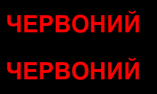
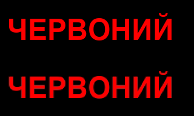
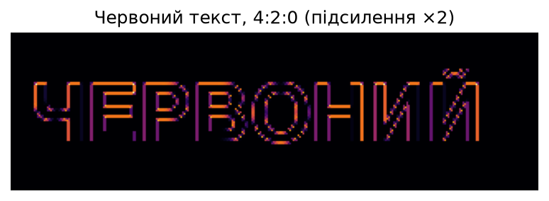
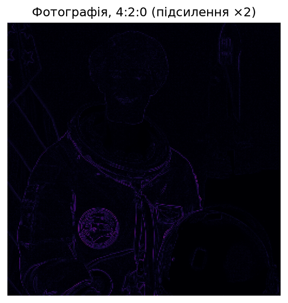
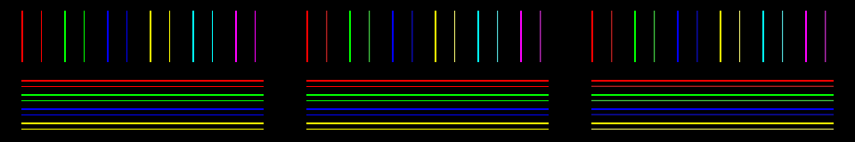

# Лабораторна робота 5. Субдискретизація кольору

**Дисципліна:** Розробка мультимедійних застосунків
**Спеціальність:** 122 Комп'ютерні науки, група КН-3/1
**Виконав:** Khomiak
**Мова та бібліотеки:** Python, NumPy, Pillow, scikit-image, matplotlib

## Мета роботи

Реалізувати вручну переведення RGB ↔ YCbCr та проріджування кольору за схемами 4:2:2 і 4:2:0, виміряти похибку на трьох тестових зображеннях і пояснити, чому субдискретизація псує червоний текст, але майже не впливає на фотографію.

## Структура репозиторію

| Файл | Призначення |
|---|---|
| `lab5.py` | усі функції та запуск вимірювань |
| `text422.png`, `text420.png` | червоний текст до і після 4:2:2 та 4:2:0 |
| `lines420.png` | тонкі лінії під схемами 4:4:4, 4:2:2, 4:2:0 |
| `diff_text.png`, `diff_photo.png` | карти різниці для тексту й фотографії |

Запуск: `python lab5.py`

## Хід роботи

### Завдання 1. RGB → YCbCr → RGB

Я написав функції `rgb2ycbcr` та `ycbcr2rgb`. Усі обчислення вів у `float64`, а в `uint8` переводив лише наприкінці після `np.clip` та округлення. На фотографії `astronaut()` з scikit-image максимальна похибка переходу туди й назад склала **0**, отже сам перехід у YCbCr нічого не псує і вся подальша похибка спричинена лише проріджуванням.

### Завдання 2. Схема 4:2:2

Я реалізував:

- `down422(C)` — усереднення пар сусідніх значень по горизонталі: `C.reshape(h, w // 2, 2).mean(axis=2)`;
- `up422(C, w)` — відновлення повтором: `np.repeat(C, 2, axis=1)[:, :w]`.

Функція `scheme(img, mode)` переводить зображення в YCbCr, проріджує `Cb` і `Cr` (канал `Y` не змінюється) і переводить назад. Тестове зображення — червоний напис «ЧЕРВОНИЙ» на чорному тлі. Максимальна похибка для 4:2:2 склала **87**.



*Рисунок 1 — Червоний текст: оригінал (зверху) і 4:2:2 (знизу)*

### Завдання 3. Схема 4:2:0

Я додав:

- `down420(C)` — усереднення квадратів 2×2: `C.reshape(h // 2, 2, w // 2, 2).mean(axis=(1, 3))`;
- `up420(C, h, w)` — подвійний `np.repeat` по осях 0 і 1 із зрізом `[:h, :w]`;
- гілку `mode == '4:2:0'` у функції `scheme`.

Максимальна похибка склала **123** (по каналах R — 123, G — 52, B — 52). Найбільше постраждав червоний канал, бо саме він присутній на зображенні.



*Рисунок 2 — Червоний текст: оригінал (зверху) і 4:2:0 (знизу)*

### Завдання 4. Карта різниці

Я побудував карту різниці як найбільшу з трьох похибок каналів у кожному пікселі (`d.max(axis=2)`). Щоб слабкі похибки було видно, карту помножено на **2**, тому яскравість на ній удвічі більша за справжню похибку. Для тексту похибка зібралася на контурах літер, для фотографії карта практично чорна.



*Рисунок 3 — Карта різниці для червоного тексту, 4:2:0 (підсилення ×2)*



*Рисунок 4 — Карта різниці для фотографії, 4:2:0 (підсилення ×2)*

### Завдання 5. Таблиця вимірювань

Я додав тестове зображення з тонкими кольоровими лініями завтовшки 1 і 2 пікселі, написав функцію `measure` і проганяв усі три зображення через усі три схеми. Величини:

- **макс** — найбільша похибка в будь-якому каналі будь-якого пікселя;
- **середня** — середня похибка по всіх пікселях і каналах;
- **змінених** — частка пікселів із ненульовою похибкою;
- **помітних** — частка пікселів із похибкою понад 30.

| Зображення | Схема | Макс | Середня | Змінених | Помітних |
|---|:---:|:---:|:---:|:---:|:---:|
| червоний текст | 4:4:4 | 0 | 0,00 | 0,0 % | 0,00 % |
| червоний текст | 4:2:2 | 87 | 1,32 | 6,9 % | 4,53 % |
| червоний текст | 4:2:0 | 123 | 1,89 | 8,8 % | 5,86 % |
| тонкі лінії | 4:4:4 | 0 | 0,00 | 0,0 % | 0,00 % |
| тонкі лінії | 4:2:2 | 113 | 0,58 | 1,4 % | 1,25 % |
| тонкі лінії | 4:2:0 | 113 | 2,24 | 5,6 % | 4,96 % |
| фотографія | 4:4:4 | 0 | 0,00 | 0,0 % | 0,00 % |
| фотографія | 4:2:2 | 43 | 0,97 | 76,4 % | 0,04 % |
| фотографія | 4:2:0 | 58 | 1,25 | 81,3 % | 0,12 % |

*Таблиця 1 — Результати вимірювань*

Усі дев'ять рядків збіглися з контрольними значеннями. Схема 4:4:4 дала нулі в усіх трьох рядках, тож уся похибка в інших схемах походить виключно від проріджування.



*Рисунок 5 — Тонкі лінії: 4:4:4, 4:2:2, 4:2:0 (зліва направо)*

На цьому зображенні видно різницю між схемами за напрямком усереднення: 4:2:2 усереднює лише по горизонталі, тому горизонтальні лінії залишилися без змін (похибка 0), а вертикальні зіпсувалися (до 113). Схема 4:2:0 усереднює ще й по вертикалі, тому постраждали обидва напрямки.

### Додатково: порівняння з Pillow JPEG

Я зберіг той самий напис через Pillow з однаковою якістю `quality=92`:

```python
Image.fromarray(txt).save('q92_444.jpg', quality=92, subsampling=0)  # 4:4:4
Image.fromarray(txt).save('q92_420.jpg', quality=92, subsampling=2)  # 4:2:0
```

Файл із `subsampling=0` важить 10 355 байт, а з `subsampling=2` — 6 722 байти. Якість квантування однакова, а відмінність у вигляді кольорових країв літер виникає через субдискретизацію, яка виконується до квантування.

## Відповіді на запитання

**1. Скільки чисел зберігається на квадрат 2×2 пікселі? Який відсоток обсягу економить кожна схема?**
У схемі 4:4:4 — 12 чисел (4 Y + 4 Cb + 4 Cr), у 4:2:2 — 8 чисел (4 Y + 2 Cb + 2 Cr), у 4:2:0 — 6 чисел (4 Y + 1 Cb + 1 Cr). Економія становить 0 %, 33 % (третина) та 50 % (половина) відповідно.

**3. Де на карті різниці зібралася похибка і чому саме там?**
На карті для тексту похибка зібралася вузькими смугами на контурах літер, а всередині літер і на чорному тлі її майже немає. Усереднення змінює значення лише там, де сусідні пікселі мають різний колір: усередині однорідної області середнє дорівнює самим значенням. На межі червоного й чорного значення `Cr` (240 і 128) усереднюються до 184, тому літера «заливається» за край, а тло червоніє.

**4. Чому зіпсованим виглядає текст, а не фотографія, хоча у фотографії змінилося більше пікселів?**
У фотографії змінилося 81,3 % пікселів, але лише 0,12 % змінилося більше ніж на 30, тобто з сімсот змін помітна приблизно одна. На фотографії сусідні пікселі мають близький колір, тож усереднення дає зміну на кілька одиниць, непомітну оку. У тексту змінилося лише 8,8 % пікселів, але 5,86 % мають похибку понад 30, тобто близько двох третин усіх змін помітні одразу: усі вони лежать на різких межах між насиченим кольором і відсутністю кольору.

## Висновки

Я реалізував переведення RGB ↔ YCbCr без втрат і схеми 4:2:2 та 4:2:0 вручну на NumPy. Субдискретизація дає економію 33 % і 50 % обсягу, при цьому на фотографіях вона майже непомітна, а на різких кольорових краях (текст, тонкі лінії) спричиняє значну похибку. Тому для зображень з дрібним кольоровим текстом доцільно використовувати формат без субдискретизації кольору.