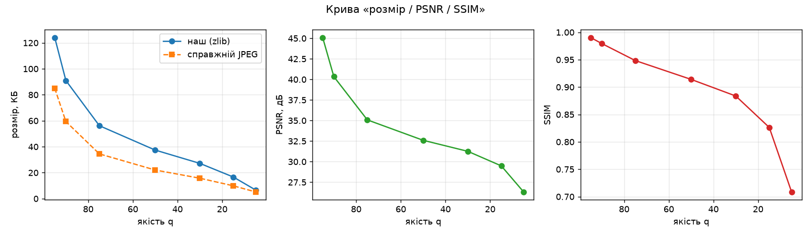
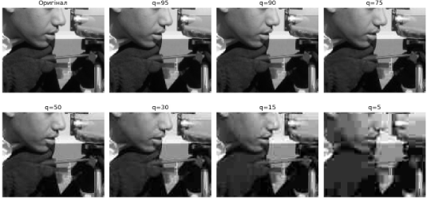
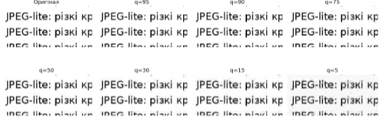
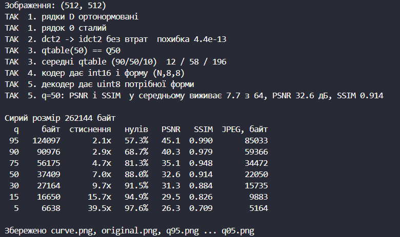

# Лабораторна робота 6. JPEG-lite

## Мета роботи

Зібрати власний кодер зображень за схемою JPEG без останнього (ентропійного) кроку: DCT 8×8, квантування з таблицею, що залежить від якості, зворотний хід; побудувати криву «розмір / PSNR / SSIM» і знайти власний поріг видимості артефактів.

## Хід роботи

### Завдання 1. Базис DCT

Я побудував матрицю `D` розміру 8×8 за формулою із завдання та реалізував `dct2(block) = D @ block @ D.T` і `idct2(coeffs) = D.T @ coeffs @ D`. Перевірив, що рядки `D` ортонормовані, а рядок 0 сталий. Після `dct2` → `idct2` над блоком із фотографії похибка склала близько 1e-13, тобто перетворення не втрачає нічого.

### Завдання 2. Таблиця квантування

Я реалізував `qtable(q)` за формулою з підрозділу 2.3 (множник `S`, округлення додаванням 50, обмеження `np.clip(..., 1, 255)`). При q = 50 вийшла рівно базова таблиця `Q50`. Середні значення таблиці: 12 при q = 90, 58 при q = 50 і 196 при q = 10.

### Завдання 3. Кодер і декодер

У кодері я відняв 128 від пікселів, розбив зображення на блоки 8×8, для кожного виконав `dct2`, поділив на таблицю `Q`, округлив і привів до `int16`. У декодері помножив коефіцієнти на `Q`, виконав `idct2`, зібрав блоки, додав 128 і обрізав значення до 0…255 перед переведенням у `uint8`. Усі тести в `lab6.py` проходять без жодного «НІ». При q = 50 у блоці в середньому виживає 7,7 коефіцієнта з 64, PSNR становить 32,6 дБ, SSIM — 0,914.

### Завдання 4. Крива якості

Я прогнав зображення (сирий розмір 262 144 байт) через сім значень якості. Розмір рахував як довжину квантованих коефіцієнтів, стиснутих zlib; для порівняння додав розмір справжнього JPEG тієї ж якості, збереженого через Pillow.

| q | байт | стиснення | нулів | PSNR, дБ | SSIM | ср. ненульових | JPEG, байт |
|---:|---:|---:|---:|---:|---:|---:|---:|
| 95 | 124 228 | 2,1× | 57,3 % | 45,1 | 0,990 | 27,3 | 85 033 |
| 90 | 91 292 | 2,9× | 68,7 % | 40,3 | 0,979 | 20,0 | 59 366 |
| 75 | 56 743 | 4,6× | 81,3 % | 35,1 | 0,948 | 11,9 | 34 472 |
| 50 | 38 045 | 6,9× | 88,0 % | 32,6 | 0,914 | 7,7 | 22 050 |
| 30 | 27 688 | 9,5× | 91,5 % | 31,3 | 0,884 | 5,5 | 15 735 |
| 15 | 17 230 | 15,2× | 94,9 % | 29,5 | 0,826 | 3,3 | 9 883 |
| 5 | 6 913 | 37,9× | 97,6 % | 26,3 | 0,709 | 1,6 | 5 164 |

*Таблиця 1 — Результати для основного зображення*


*Рисунок 1 — Крива «розмір / PSNR / SSIM»*

Від якості 95 до якості 50 файл меншає з 124 228 до 38 045 байт, а SSIM падає з 0,990 до 0,914. Нижче якості 30 економія вже невелика, а SSIM швидко падає: з 0,884 до 0,709 при q = 5. Отже, якість 90 і вище — марна трата місця, нижче 30 — видимі збитки, а робочий діапазон для фотографій — приблизно від 40 до 80.

### Завдання 5. Власний поріг видимості

Я переглянув оригінал і файли `q95.png` … `q05.png` у масштабі 100 % від найкращої якості до найгіршої (на рисунку 2 — збільшений фрагмент) і зупинився там, де вперше побачив різницю з оригіналом. **Мій поріг видимості: q = 50, на ньому PSNR = 32,6 дБ, SSIM = 0,914.**


*Рисунок 2 — Той самий фрагмент при різній якості*

**Перевірка на другому зображенні.** Як зображення іншого типу я взяв рисунок із текстом і різкими краями.

| q | байт | стиснення | нулів | PSNR, дБ | SSIM | ср. ненульових | JPEG, байт |
|---:|---:|---:|---:|---:|---:|---:|---:|
| 95 | 133 369 | 2,0× | 57,5 % | 47,8 | 0,998 | 27,2 | 122 952 |
| 90 | 114 960 | 2,3× | 61,7 % | 41,9 | 0,993 | 24,5 | 95 676 |
| 75 | 88 859 | 3,0× | 70,2 % | 34,5 | 0,971 | 19,1 | 66 713 |
| 50 | 69 290 | 3,8× | 76,6 % | 30,2 | 0,946 | 15,0 | 48 660 |
| 30 | 56 384 | 4,6× | 80,7 % | 27,4 | 0,923 | 12,4 | 37 989 |
| 15 | 41 096 | 6,4× | 85,4 % | 24,2 | 0,897 | 9,4 | 26 392 |
| 5 | 24 032 | 10,9× | 90,8 % | 20,4 | 0,854 | 5,9 | 16 004 |

*Таблиця 2 — Результати для зображення з текстом і різкими краями*



*Рисунок 3 — Фрагмент із текстом при різній якості*



На зображенні з текстом при q = 50 PSNR становить 30,2 дБ проти 32,6 дБ на основному, а файл займає 69 290 байт проти 38 045. Різкий край — це багато високочастотних складових; коли їх квантують грубо, навколо літер виникає «шум-ореол» (ringing) на рівному тлі, де око його добре бачить. Тому поріг для такого типу зображень зсувається в бік вищої якості, і одним числом для фото й тексту обійтися не можна.

**Порівняння метрик.** Я взяв пару сусідніх значень q = 30 і q = 15: PSNR змінився з 31,3 до 29,5 дБ (на 1,8 дБ), а SSIM — з 0,884 до 0,826 (на 0,057). На картинці при q = 15 з'являється блочність, і SSIM відреагував на неї сильніше, ніж PSNR, тому краще збігся з моїм враженням: він оцінює збереження структури, а не середню різницю пікселів.

## Відповіді на запитання

**1. Де втрачається інформація?** Єдиний рядок із втратою в кодері:

```python
coeffs = np.array([np.round(dct2(b) / Q) for b in blocks])
```

а точніше, округлення `np.round` після ділення на таблицю: дробові числа стають цілими, і всі, що менші за половину клітинки таблиці, перетворюються на нуль. До цього рядка втрат немає: віднімання 128 і `dct2` оборотні (похибка близько 1e-13), а ділення на `Q` можна скасувати множенням.

**5. Чому мій файл майже вдвічі більший за справжній JPEG?** Якість і картинки однакові, різниця лише в останньому кроці. Справжній JPEG складає 64 числа зигзагом, щоб усі нулі зібралися в довгий хвіст, і кодує його RLE та Хаффманом. Я ж стискаю коефіцієнти через zlib без зигзагу, тому нулі упаковані менш щільно. При q = 50 у мене 38 045 байт проти 22 050 байт у справжнього JPEG.

**6. Ваш поріг видимості і чому поріг сусіда інший?** Мій поріг — q = 50, PSNR на ньому 32,6 дБ. У сусіда поріг інший, хоча зображення те саме, бо людський зір, монітор, яскравість і масштаб перегляду в кожного різні. PSNR та SSIM — формули, для однієї картинки вони однакові в усіх, а поріг видимості суб'єктивний. Тому в технічне завдання треба записувати не одне число PSNR, а діапазон якості з перевіркою на реальних зображеннях потрібного типу (для фото ≈ 75 із запасом, для скриншотів і тексту — вище), а метрики використовувати лише як допоміжні.

## Висновки

Я побудував і перевірив власний JPEG-подібний кодер: DCT оборотне, а вся втрата зосереджена в одному рядку — округленні після ділення на таблицю квантування. Крива розмір / якість показала, що розумний діапазон для фото — приблизно 40…80. Поріг видимості суб'єктивний і залежить від типу зображення, тому PSNR та SSIM не замінюють перевірку очима.

## Запуск

                     