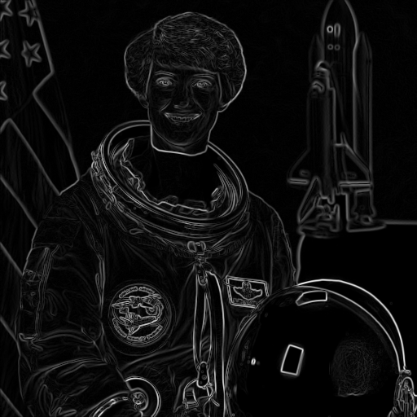
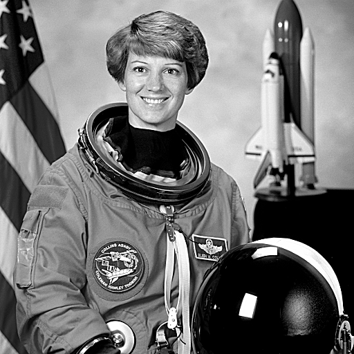

# Лабораторна робота 7. Згортка

**Дисципліна:** «Розробка мультимедійних застосунків», спеціальність 122 Комп'ютерні науки, група КН-3/1
**Виконав:** студент Хом'як

## Мета роботи

Навчитися реалізовувати згортку зображення в Python + NumPy з коректною обробкою країв, отримувати з неї розмиття за Гаусом, оператор Собеля та підвищення різкості, прискорювати розмиття за допомогою роздільних ядер і порівнювати власну реалізацію з OpenCV.

## Хід роботи

Усі завдання я виконав у файлі [`lab7.py`](lab7.py). Як тестове зображення я взяв `data.astronaut()` з scikit-image, перевів його в градації сірого та в тип `float`.

### Завдання 1. Функція згортки

Я написав функцію `conv2(img, K)`. Спершу вона доповнює зображення рамкою завтовшки `kh // 2` та `kw // 2` пікселів за допомогою `np.pad(..., mode='edge')`, тобто продовжує крайні пікселі назовні. Далі два цикли проходять по елементах ядра, а не по пікселях: на кожному кроці я множив зсунуту копію зображення `pad[i:i+h, j:j+w]` на одну вагу `K[i, j]` і додавав її до накопичувача. Результат має той самий розмір, що й вхідне зображення.

Для перевірки я застосував ядро `np.ones((3,3))/9`. Середня яскравість оригіналу 115,404, після згортки — 115,404, тобто яскравість не змінилася, і краї оброблені правильно.

### Завдання 2. Три фільтри

**Розмиття.** За функцією `gauss1d(1.6, 7)` я побудував одновимірне ядро Гауса, нормоване до суми 1, і отримав двовимірне ядро 7×7 як `np.outer(k, k)`. Результат збережено в `blur.png`.

**Собель.** Я використав ядро `SX = [[-1,0,1],[-2,0,2],[-1,0,1]]` та `SY = SX.T`, обчислив `gx` і `gy` тією самою функцією `conv2`, знайшов силу краю як `np.hypot(gx, gy)` і розтягнув її в діапазон 0…255. Результат збережено в `sobel.png`.

**Різкість.** Я обчислив деталі як різницю оригіналу та розмитого зображення і додав їх до оригіналу із силою 1,2: `sharp = clip(gray + 1.2 * (gray - blur), 0, 255)`. Результат збережено в `sharp.png`. Білих ореолів навколо країв не спостерігалося, тому силу я не зменшував.

Середнє значення по периметру розмитого зображення (104,99) майже збігається з оригіналом (104,82), отже темної рамки немає.

| Оригінал | Розмиття (7×7, σ = 1,6) | Собель | Різкість (сила 1,2) |
|:---:|:---:|:---:|:---:|
|  |  |  |  |

### Завдання 3. Роздільне розмиття й заміри

Я написав функцію `conv_sep(img, k)`, яка виконує згортку одновимірним ядром спершу по горизонталі, потім по вертикалі. Максимальна розбіжність між `conv2` і `conv_sep` для ядра 15×15 становила 4,0·10⁻¹³, а для всіх п'яти розмірів не перевищувала 9,7·10⁻¹³ — це похибка дробових чисел, тобто результати збігаються. Час я вимірював як найкращий із п'яти запусків (функція `best`).

| Ядро | Звичайне, мс | Роздільне, мс | Виграш | OpenCV, мс |
|:---:|---:|---:|---:|---:|
| 3×3 | 4,1 | 4,8 | 0,9× | 0,4 |
| 5×5 | 12,5 | 7,2 | 1,7× | 0,7 |
| 9×9 | 34,1 | 9,3 | 3,7× | 0,7 |
| 15×15 | 88,6 | 13,7 | 6,5× | 1,2 |
| 31×31 | 382,9 | 28,2 | 13,6× | 2,4 |

*Таблиця 1 — Заміри на зображенні 512×512, найкращий час із п'яти запусків.*

### Завдання 4. Порівняння з OpenCV

Для ядра 15×15 та σ = 3,0 я порівняв `conv_sep` з `cv2.GaussianBlur(..., borderType=cv2.BORDER_REPLICATE)`. Максимальна розбіжність результатів становила 2,6·10⁻¹³, тобто результати збігаються з точністю до похибки обчислень з дробовими числами. Час моєї реалізації — близько 14,7 мс, OpenCV — близько 1,0 мс, тобто OpenCV швидший приблизно у 14 разів.

## Відповіді на запитання

**3. Чому в ядрі Собеля сума ваг дорівнює нулю? Що воно дає на рівному тлі й чому?**

Ядро Собеля шукає перепади яскравості, а не усереднює її, тому ліва частина має від'ємні ваги, а права — додатні, і вони взаємно скасовуються (сума дорівнює 0). На рівному тлі всі сусідні пікселі однакові, тож додатні та від'ємні доданки гасять один одного і результат дорівнює нулю — рівна ділянка на зображенні краю чорна. На перепаді яскравості з одного боку пікселі яскравіші, з іншого темніші, баланс порушується, і виходить велике за модулем число — контур світлий.

**5. Чому виграш роздільного ядра на 3×3 майже нульовий, а на 31×31 — одинадцятикратний?**

Кількість множень на піксель у звичайній згортці дорівнює N², а в роздільній — 2N. Теоретичний виграш N²/(2N) = N/2: для 3×3 це лише 1,5×, для 31×31 — 15,5×. На малих ядрах час значною мірою складається з накладних витрат, які не залежать від розміру ядра: створення масивів, `np.pad`, два окремі проходи замість одного, звернення до пам'яті. Тому на 3×3 вони з'їдають увесь виграш (у моїх замірах 0,9×). На великих ядрах основну частину часу складають самі множення, і накладні витрати стають непомітними, тож реальний виграш наближається до теоретичного (у моїх замірах 13,6× проти 15,5×).

**6. Ваш результат збігається з OpenCV до нуля, але час відрізняється вдесятеро. За рахунок чого?**

Математика однакова, різниця в реалізації. OpenCV написаний на C++ і напряму використовує векторні інструкції процесора (SIMD), які обробляють одразу кілька чисел за одну команду. Обчислення там ведуться в цілих числах, а не в дробових, що швидше. Дані розкладені так, щоб оброблювані фрагменти вміщалися в кеш процесора, і не потрібно щоразу створювати великі проміжні масиви, як у NumPy, де кожен прохід по ядру — це окремий прохід по всій пам'яті.

## Висновки

У ході роботи я реалізував універсальну функцію згортки з обробкою країв і отримав із неї розмиття за Гаусом, оператор Собеля та підвищення різкості, змінюючи лише ядро. Роздільна реалізація дала однаковий результат з похибкою порядку 10⁻¹³ і прискорила розмиття від 1,7× на ядрі 5×5 до 13,6× на 31×31; на ядрі 3×3 виграшу немає через накладні витрати. Результат збігається з OpenCV, але бібліотека швидша приблизно в 14 разів завдяки оптимізованій реалізації.

## Структура репозиторію

- `lab7.py` — код (`conv2`, `conv_sep`, три фільтри, заміри, порівняння з OpenCV);
- `original.png`, `blur.png`, `sobel.png`, `sharp.png` — результати;
- `README.md` — цей звіт.