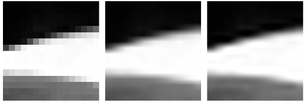
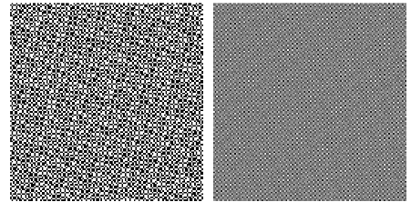
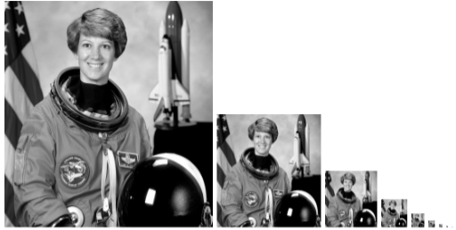

# Лабораторна робота 8. Ресемплінг і міпмапи

## Мета роботи

Дослідити два способи збільшення зображення (nearest, bilinear), виявити аліасинг при зменшенні проріджуванням, побудувати ланцюжок міпмап і виміряти, наскільки наївне усереднення кодів sRGB робить міпмапи темнішими за побудовані через лінійне світло.

## Хід роботи

Роботу я виконав мовою Python з бібліотеками NumPy, Pillow і scikit-image у файлі [`lab8.py`](lab8.py). Функції `to_light` і `to_code` виконують перетворення між кодами sRGB та лінійним світлом, `half_naive` усереднює квадрати 2×2 напряму, а `half_linear` робить те саме між двома гама-перетвореннями.

### Завдання 1. Збільшення

Я взяв фрагмент 16×16 пікселів із сірої версії фотографії `astronaut` (рядки 340–356, стовпці 372–388) і збільшив його в двадцять разів до 320×320 трьома способами: `Image.NEAREST`, `Image.BILINEAR` та `Image.LANCZOS`.

*Рисунок 1 — Збільшення фрагмента 16×16: nearest, bilinear, lanczos (зліва направо)*

Відкривши результати, я порівняв їх. У nearest чітко видно квадрати 20×20 пікселів: я перевірив програмно, що зображення складається з однорідних блоків такого розміру, а різних значень яскравості в ньому лише 90 (стільки було у вихідному фрагменті). У bilinear переходи плавні, значень яскравості 255, але зображення трохи розмите, бо кожен новий піксель є зваженою сумішшю чотирьох сусідів. Lanczos дає найчіткіші краї при плавних переходах, проте поблизу різких меж можливі легкі «дзвінки». Середня абсолютна різниця між nearest і bilinear склала 6,74, між bilinear і lanczos — 3,19.

Nearest доречний, коли потрібна швидкість або чітко видимі пікселі (піксель-арт, відлагодження); bilinear — швидкий компроміс для звичайного збільшення; lanczos — коли важлива якість і різкість.

### Завдання 2. Зменшення й аліасинг

Я згенерував шахівницю 512×512 з клітинкою 4 пікселі, повернуту на 18°, і зменшив її вчетверо двома способами: взявши кожен 4-й піксель (`ch[::4, ::4]`) та усередненням блоків 4×4 (`reshape` + `mean` по осях 1 і 3).

*Рисунок 2 — Зменшена шахівниця: кожен 4-й піксель (ліворуч), усереднення 4×4 (праворуч)*

| Спосіб | Середнє | Розкид |
|---|---|---|
| кожен 4-й піксель | 127,5 | 127,5 |
| усереднення 4×4 | 127,5 | 44,6 |

*Таблиця 1 — Зменшення шахівниці у 4 рази*

Середнє в обох випадках однакове — 127,5, тому за самим середнім помилку не видно. Різницю показує розкид: при прорідженні він лишився 127,5, тобто кожен піксель так і лишився або чорним, або білим, а на `ds_nearest.png` проступили світлі й темні плями, яких немає у вихідній шахівниці. Це аліасинг. При усередненні розкид впав до 44,6, бо з'явилися проміжні відтінки.

### Завдання 3. Ланцюжок міпмап

Я зменшував сіре зображення 512×512 удвічі усередненням квадратів 2×2 доти, доки сторона не стала меншою за 2. Вийшло 9 рівнів: 512, 256, 128, 64, 32, 16, 8, 4, 2 (файли `mip_0.png` … `mip_8.png`). Середня яскравість на всіх рівнях однакова й дорівнює 115,4.

*Рисунок 3 — Ланцюжок міпмап (рівні 0–8)*

### Завдання 4. Скільки коштує гама

Спочатку я перевірив обидві функції на шахівниці з клітинкою в один піксель. Наївне усереднення дало 127,5, а усереднення через світло — 187,5. Різниця дорівнює рівно 60 одиницям.

| Спосіб | Середній код |
|---|---|
| наївно (усереднення кодів) | 127,5 |
| правильно (через лінійне світло) | 187,5 |

*Таблиця 2 — Шахівниця 1×1 після зменшення вдвічі*

Потім я зменшував фотографію п'ять разів поспіль обома способами й записував середню яскравість кожного рівня.

| Рівень | Розмір | Наївно | Правильно | Різниця |
|---|---|---|---|---|
| 0 | 512 | 115,4 | 115,4 | 0,0 |
| 1 | 256 | 115,4 | 116,0 | +0,6 |
| 2 | 128 | 115,4 | 117,1 | +1,7 |
| 3 | 64 | 115,4 | 118,9 | +3,5 |
| 4 | 32 | 115,4 | 122,0 | +6,6 |
| 5 | 16 | 115,4 | 127,4 | +12,0 |

*Таблиця 3 — Середня яскравість рівнів міпмапи*

Наївна колонка стоїть на місці, а правильний ланцюжок з кожним рівнем світлішає, і різниця накопичується від +0,6 до +12,0. Отже, наївні міпмапи систематично темніші за правильні.

### Додатково: поведінка Pillow

Я зменшив шахівницю 512×512 до 128×128 режимами NEAREST, BOX і LANCZOS. Результат BOX (`lib_box.png`) збігся з `ds_area.png` з розбіжністю не більше 1 одиниці. Потім я зменшив шахівницю з клітинкою в один піксель удвічі режимом BOX: середнє вийшло 128, а не 188. Отже, Pillow усереднює коди напряму і гаму не враховує.

## Відповіді на запитання

**1. Звідки взялися плями аліасингу на `ds_nearest.png`?**
У вихідній шахівниці клітинка має 4 пікселі, і ми брали кожен 4-й піксель, тобто крок вибірки дорівнює розміру деталі. Вибірка то влучає в чорні клітинки, то в білі залежно від того, як зсувається межа відносно кроку. Три з кожних чотирьох пікселів не враховуються взагалі, і дрібні деталі перетворюються на хибний візерунок більшого масштабу (муар). Плями народилися з самої процедури вибірки, а не з даних.

**2. Чому середнє однакове, а якість різна?**
Середнє показує лише загальну кількість яскравості й не бачить просторової структури. При прорідженні ми отримали вибірку чорних і білих пікселів, частка яких у середньому лишилася половинною, тому середнє 127,5, але візерунок хибний. При усередненні кожен піксель став сірим, що правильно відображає чергування дрібних клітинок. Правильність видно по розкиду (127,5 проти 44,6) і на око.

**3. Чому для збільшення годиться будь-який спосіб, а для зменшення лише усереднення?**
Під час збільшення вихідні дані повністю зберігаються, а нові пікселі лише доповнюються інтерполяцією. Під час зменшення інформацію треба викинути, і якщо просто відкинути пікселі, дрібні деталі потрапляють у вибірку випадково й дають аліасинг. Усереднення спершу прибирає деталі, дрібніші за крок вибірки.

**4. Скільки місця займає ланцюжок міпмап?**
Кожен рівень вчетверо менший за площею, тому сума 1/4 + 1/16 + 1/64 + … є геометричною прогресією зі знаменником 1/4 і дорівнює (1/4)/(1 − 1/4) = 1/3. Ланцюжок додає приблизно третину пам'яті, разом близько 4/3 від оригіналу.

**5. Чому збереження середньої яскравості 115,4 — це помилка?**
Числа у файлі — це коди sRGB, а не кількість світла, і залежність між ними нелінійна. Усереднення кодів зберігає середній код, але не середню кількість світла. Правильний ланцюжок світлішає (на шахівниці 127,5 → 187,5, на фото до 127,4 на п'ятому рівні), тож незмінна яскравість свідчить, що наївний ланцюжок рахує не те.

**6. Що вмикає прапорець sRGB для текстур?**
Він змушує рушій перетворювати коди текстури на лінійне світло перед усередненням при побудові міпмап, а потім повертати результат у sRGB. Якщо його забути, віддалені поверхні, які показуються з глибоких рівнів міпмап, виглядають помітно темнішими за ближні.

## Висновки

У лабораторній роботі я перевірив на практиці дві пастки ресемплінгу. По-перше, зменшувати зображення проріджуванням не можна: на шахівниці з клітинкою 4 пікселі під кутом 18° воно дало аліасинг (розкид 127,5 проти 44,6 при усередненні 4×4), хоча середнє в обох способах було 127,5. По-друге, усереднювати коди sRGB напряму не можна: на шахівниці 1×1 наївний результат 127,5 проти правильного 187,5, а на фотографії наївні міпмапи на п'ятому рівні темніші на 12,0 одиниць. Збільшувати зображення можна будь-яким способом, а зменшувати — тільки через усереднення в лінійному світлі.